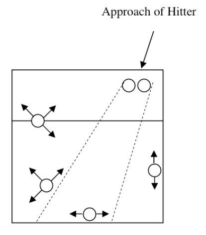

- Dates: 2022-05-01 – present
- Status: unfinished
- Importance: 4

It’s Halloween 2026. I’ve gotten up at 6:30am before we head out to Wilson Farm and I'm sitting down to write something I’ve been meaning to all week: “Journey of an amateur volleyball player.” Why?

I’ve been into volleyball for four years now, since May 2022, when I was 28. Before that, I hadn’t played since middle school PE. Then, on a PhD retreat in 2022, my classmate Eric Bartell invited me to join for some beach 3v3. We weren’t very good (except Eric), but hey, I had a ton of fun playing. I hadn’t remembered it being so much fun! So after returning from the retreat to Boston, I joined Eric’s twice-per-week Harvard Medical School (HMS) pickup grass volleyball group, and there began my obsession. I've played volleyball for 5-10 hours per week for four years.

I picked it up decently at the beginning. I thought I had bumping and serving down from high school, and focused on learning setting and spiking. I watched Coach Donny’s Elevate Yourself videos on YouTube to teach myself proper form for each. Setting -- take the ball on my forehead and use my thumb and index fingers to push the ball up so the fingers trace out a rectangle. Spiking -- two-step jump approach, do the Zeus pose with the arms in the air, then flick everything (wrist, tricep, lat/shoulder, core) at once when the ball is right in front. I became one of the more powerful spikers in our pickup group. This initial success got me even more obsessed, and I kept watching Coach Donny videos and being that strange guy who practiced spiking form while walking around the office.

What made volleyball so fun? I think part of it was seeing myself make progress and become decent pretty quickly. I didn’t have too many activities like that at the time, especially physical ones -- it was harder to see my “skill progress” at work, biking around Boston, reading/writing, or singing (where I felt I’d plateaued). Plus, it was a *team* sport. It was fun to get to know other students and young professionals on top of getting exercise. And most importantly -- it was super fun to play as a team and celebrate hype plays with teammates. Pulling off a powerful spike down the line and seeing my teammates look in awe -- that could replay in my head dozens of times during the week. And I loved high-fiving teammates after they pulled off a crazy block or dig.[^bball]

Through this shared experience and teamwork, I've made many friends through volleyball. We’ve played together in BSSC leagues or Harvard IMs or pickup or as college friends in Palo Alto. We've played grass 2s or indoor hard court 6s, on hot summer days or indoors in the winter (yes, I’ve trekked through snow to play). It’s been a fun, consistent source of exercise and de-stressing for me.

Around 5 months after I started playing, in November 2022, I started feeling right shoulder pain from all the spiking. At first I ignored it, but it wouldn’t go away for a week whenever I lifted my arm overhead, so I went to see my PCP and then the PT. My PT Becca told me I had rotator cuff-related weakness and advised me not to play for a few months while we rehabbed it. Initially I felt crushed -- yes, apparently I missed volleyball that much, and part of me was even worried that I’d never be able to play again (or at least, to play without worrying about my shoulder). But the sensible side of me knew that it was probably a good idea to rest and rehab, so I followed Becca’s program for those months -- lat pulls, internal and external rotator cuff rotation exercises, the doorway stretch, etc. Then one day, I got a pleasant surprise: Becca told me “you can try playing again.” I biked away from that PT appointment super happy and when the GroupMe message went out asking who was coming to the next volleyball session, I eagerly liked it for the first time in a while. In the days leading up to that session, I had moments of worry about how I would play while also spiking properly to avoid re-injuring my shoulder. But the day came, I happily reunited with friends, I played, I felt fine, and I was back at it. I turned that PT program into a 10-minute warmup routine that I now do before every volleyball session, and for years I didn’t have any returns of the shoulder issue.

Yet I did have a recent flareup of temporary shoulder pain, and it reminds me that, as much as I’ve learned in volleyball, there is still room to grow. In all these years, I think my spiking form has been OK but not *the healthiest* for my shoulder, and my guess is that it hasn’t caused more shoulder problems either because my spiking isn’t powerful enough or because of my warmup program strengthening my rotator cuff. So I recently decided that I would once and for all fix my meh spiking habits -- and yes, at the cost of making hitting errors while I learn and adjust to the right form. But I guess this is the long road for volleyball -- there’s always another level huh?

When I make trips to Palo Alto, I join my college friends' family volleyball game. They've had a weekly Sunday game for years that attracts family friends of all ages: from high schoolers to a 60-year old man who used to play volleyball in college (he's quite good). I hope I can similarly make volleyball a lifelong tradition.

### Other tidbits from the long road so far

- I had three-quarters of a year with both thumbs sprained, which made hand passing, setting, and blocking ill-advised and painful. I figured out workarounds for each -- only bump (no overhead) passing, setting with my index and middle fingers instead of my thumb and index fingers, and... mostly not blocking (because at my level, blocking isn’t *that* valuable). I recently healed and then slightly jammed my right thumb again, motivating me to add thumb exercises to my warmups.
- I’ve had a long up-and-down relationship with serve receive. Back when I started, people weren’t making difficult serves so it must not have been an issue, but when I started playing in official leagues and with better players, I ran into some really difficult float serves or just well-placed serves that really made me move. Serve receive (for the non-players, it’s “bumping” on the serve) is surprisingly important in volleyball -- if you can’t get that first pass nice and controlled to your setter, you won’t be able to do any of those dazzling spikes. I’ve been trying to improve (and have improved somewhat?) at the psychological, footwork, arm/shoulder form, and angling/platform aiming aspects of serve receive. (And because of the thumb things, I’ve mainly been handling those annoying floats with my platform.)

### Volleyball strategy

My good friend Carl (who I used to play basketball with) asked me this: "As a non volleyball guy I always wonder how interesting the team [volleyball] strategy can get, because it seems like just 'bump set spike' every time, versus basketball which has tons of different plays." Some quick thoughts:

- At my level, I think volleyball has a decent amount of strategy but is also still a lot about good technique and minimizing errors on passing (bumping) especially (see my "up-and-down relationship with serve receive") and also serving, setting, and spiking. That being said:
- One of my favorite strategic decisions as a spiker/hitter is where and how to hit the ball to land it on the ground and avoid the 6 defenders (it can be surprisingly hard to find open ground). As a hitter, you're often approaching a defense positioned like below, with variations. If the right-side defender isn't close enough to the right sideline, you can hit down that line. If the right-side defender is too far away from the baseline and the baseline defender is too far away from the right sideline, you can aim for the right baseline corner. If the four back defenders are too close to the lines, you can try to drop a roll shot in the middle (called "campfire"). Being able to see the defense right before you jump for the spike, and then quickly making a decision in the air and having the technique to execute each of these shots, is part of the challenge.

- Correspondingly, a major aspect of team strategy is team defense: where to position the blockers and back defenders on spikes to counter the aforementioned hitter decision-making. The defense also needs to be ready for non-spikes like overpasses (when the other team accidentally passes the ball over the net) and setter dumps/tips (when the setter surprisingly sends the ball over to an open spot instead of setting their spiker). One common counterintuitive thing amateur players need to learn is that "sides get short": the two side back players typically cover short balls (including (a) balls in front of the middle-back defender(!) and (b) tips over the block) and the middle-back player gets deep (including balls behind the other two back defenders).
- The setter also shapes team strategy in determining which spikers to set to and where and how fast to set them. They need to account for where the pass is (this affects which sets are feasible -- e.g. it's less effective to set the middle spiker from far off the net), the different spiker skill levels/"hot streaks" and whether they need to get into a rhythm, the need to diversify and make the offense unpredictable for the opposing defense, etc. The opposing blockers and defenders correspondingly need to read the setter and spikers to predict which spiker will be set and where.
- Servers also make decisions on who to serve to (often seeking the weakest passer, or serving "in the seam" between passers to cause communication breakdowns) and which kinds of serves to send (topspin vs. float, short vs. deep, etc.).
- In 2s volleyball, team defense is an even more important strategic issue: it's much harder for two people to cover the court than six (although the court is smaller). Teammates need to work out their defensive scheme in advance and really try to read where the spiker will put the ball.

### Footnotes

[^bball]: The volleyball celebrations remind me of celebrating with teammates after crazy basketball plays (I used to play basketball). But in volleyball, they have a culture of frequently high-fiving after every point.